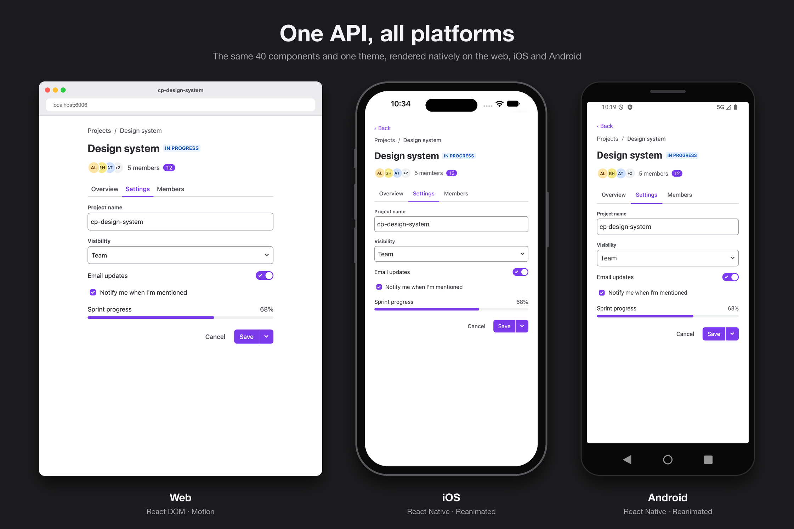

# cp-design-system

[](https://www.npmjs.com/package/cp-design-system) [](https://www.npmjs.com/package/cp-design-system) [](https://github.com/roshanpatil2000/cp-design-system/actions/workflows/ci.yml) [](LICENSE)

Animated, brand-themable design system for React (web) and React Native, built on Atlassian's design tokens. **41 components**, one API on both platforms. Published to npm as [`cp-design-system`](https://www.npmjs.com/package/cp-design-system); full component docs are in [packages/cp-design-system/README.md](packages/cp-design-system/README.md).

**[Live demos and docs (Storybook)](https://roshanpatil2000.github.io/cp-design-system/)**

```bash
yarn add cp-design-system
```

```tsx
import { Button, ThemeProvider, createTheme } from 'cp-design-system';

const theme = createTheme({ brand: '#7C3AED' });

export function App() {
  return (
    <ThemeProvider theme={theme}>
      <Button appearance="primary">Save</Button>
    </ThemeProvider>
  );
}
```

The same import works in a React web app and in a React Native or Expo app. On native, also install the peer dependencies `react-native-reanimated`, `react-native-worklets` and `react-native-gesture-handler` (see the [package README](packages/cp-design-system/README.md#install)).

## One API, all platforms



The same components from `cp-design-system`, rendered natively on each platform: the DOM with Motion on the web, and native views with Reanimated and Gesture Handler on iOS and Android. The screen shows Breadcrumbs, Heading, Lozenge, AvatarGroup, Badge, Tabs, TextField, Select, Toggle, Checkbox, ProgressBar, Button and SplitButton, all in one violet brand theme. It's `apps/storybook/stories/Showcase.stories.tsx` on the web and `apps/expo-example/Showcase.tsx` on mobile. To regenerate the image, see [docs/showcase](docs/showcase/README.md).

## Components

| Group           | Components                                                                                                               |
| --------------- | ------------------------------------------------------------------------------------------------------------------------ |
| Building blocks | Box, Stack, Inline, Text, Heading, Icon, Pressable                                                                       |
| Actions         | Button, IconButton, LinkButton, SplitButton                                                                              |
| Forms           | TextField, TextArea, Select, Checkbox, RadioGroup / Radio, Toggle, Range, Field                                          |
| Feedback        | Flag (toast), Banner, SectionMessage, Spinner, ProgressBar, ProgressIndicator, Lozenge, Badge, Tag, Skeleton, EmptyState |
| Overlays        | Modal Dialog, Drawer (bottom sheet on native), Popup, InlineDialog, Tooltip, DropdownMenu                                |
| Navigation      | Tabs, Breadcrumbs, Pagination                                                                                            |
| Display         | Carousel, Avatar, AvatarGroup                                                                                            |

Every component:

- **Looks like Atlassian** out of the box: colors, spacing, type and motion come from `@atlaskit/tokens`.
- **Takes your brand.** `createTheme({ brand })` re-colors everything with WCAG-safe contrast. `theme.components.X` sets default props, tokens and motion per component, and the `tokens` and `motion` props override one instance.
- **Moves.** Springs and micro-interactions use Motion on the web and Reanimated on the UI thread on native, with gestures from Gesture Handler. All of it respects the OS reduced-motion setting.
- **Is accessible.** Each component uses the right roles and states, keyboard support on web, focus management in overlays, and screen-reader labels on native.
- **Is tested on both platforms.** Vitest covers the web, Jest covers native, and each component has a Storybook story and an Expo demo screen.

## How it works

**Tokens.** `yarn workspace cp-design-system sync-tokens` reads Atlassian's raw tokens from `@atlaskit/tokens` (a pinned dev dependency) and writes typed files to `src/tokens/atlassian/*.generated.ts`. Those files are committed, so the published package doesn't depend on Atlaskit. CI fails if they drift from the pinned version.

**Theme.** `createTheme()` in `src/theme/` layers brand ramps (OKLCH, matched to Atlassian's Blue lightness curve), contrast fixes and user overrides on top of the tokens. `ThemeProvider` adds the color mode, the reduced-motion setting and haptics.

**Components.** Each component has shared logic and two thin renderers:

```
src/components/Toggle/
├─ Toggle.types.ts     # props, identical on both platforms
├─ Toggle.tokens.ts    # default style tokens, derived from the theme
├─ useToggle.ts        # shared state (controlled / uncontrolled)
├─ Toggle.web.tsx      # DOM + Motion
└─ Toggle.native.tsx   # React Native + Reanimated + Gesture Handler
```

Shared internals live in `src/components/internal/`:

- the dropdown `Menu` used by Select, SplitButton and DropdownMenu
- placement logic that flips and clamps every anchored overlay
- field labels and messages
- status icons

`src/index.web.ts` and `src/index.native.ts` export the matching renderers. tsup builds them to `dist/web` and `dist/native`. The `exports` map in `package.json` sends Metro to the native build (`react-native` condition) and every other bundler to the web build. The web build never imports `react-native` or Reanimated, and the native build never imports Motion.

## Repo layout

| Path                        | What                                                               |
| --------------------------- | ------------------------------------------------------------------ |
| `packages/cp-design-system` | The published package                                              |
| `apps/storybook`            | Storybook (web). Reads package **source**, so edits hot-reload     |
| `apps/expo-example`         | Expo app. Uses the **built** package, exactly like a real consumer |
| `docs/showcase`             | Script and instructions for the README's device screenshot         |

## Development

```bash
yarn install
yarn storybook          # web playground at http://localhost:6006
yarn dev                # rebuild the package on change (needed for the Expo app)
yarn example            # start the Expo app (press i for iOS simulator)
yarn test               # Vitest (web) + Jest (native)
yarn typecheck && yarn lint
yarn workspace cp-design-system check:worklets   # after a build: worklets must not capture module objects
```

On every pull request and push to `main`, CI checks that the generated tokens match the pinned `@atlaskit/tokens`, then runs lint, format, the package typecheck, both test suites, the build and the worklet check.

### Adding a component

Components land one per pull request, each fully tested on both platforms.

1. Create `src/components/Foo/` following the layout above. `useComponent('Foo', props, getFooTokens)` from `src/theme/useComponent.ts` merges theme default props, resolves tokens (defaults, then the theme's overrides, then the instance's `tokens` prop) and picks the spring (from the `motion` prop, then the theme, then a fallback).
2. Add `Foo?: ComponentTheme<FooProps, FooTokens>` to `ComponentThemes` in `src/theme/types.ts`.
3. Export the renderer from `index.web.ts` and `index.native.ts`, and its types from `shared.ts`.
4. In native worklets (animated styles, gesture callbacks), import `springTo`, `timeTo`, `stopAnimation`, `mixColors` and `runOnJS` from `src/motion/worklet.native.ts`, and start every worklet with a `'worklet'` directive.
5. Add `Foo.web.test.tsx` and `Foo.native.test.tsx`, a story in `apps/storybook/stories`, and a section in the Expo example.
6. Don't give a data file a name that differs from a component file only by case. For example, next to `FieldLabel.native.tsx`, name it `fieldLabelStyle.ts`, not `fieldLabel.ts`. On case-insensitive file systems, Metro and Jest can resolve the wrong one.

## Publishing

npm, yarn, pnpm and bun all install from the **npm registry**, so publishing once to npm covers all of them.

Releases are automatic. The Release workflow runs on every push to `main` and publishes the package **only when its version isn't on npm yet**. No npm token is stored anywhere: GitHub Actions authenticates through npm [trusted publishing](https://docs.npmjs.com/trusted-publishers).

**To release a change:**

1. In your branch, bump the version from `packages/cp-design-system`:
   ```bash
   npm version patch --no-git-tag-version   # or minor / major
   ```
2. Commit the `package.json` change with your PR and merge it to `main`.
3. The workflow runs typecheck, tests and the build, publishes to npm, and tags the commit `vX.Y.Z`.

Merges that don't change the version publish nothing.

**Use patch** for fixes (0.6.0 → 0.6.1), **minor** for new components or props (0.6.1 → 0.7.0) and **major** for breaking changes (0.x → 1.0.0). Release notes are in the [changelog](packages/cp-design-system/CHANGELOG.md).

> Never run `yarn add cp-design-system` or `npm install cp-design-system` inside this repo. The apps already use the local package, and installing it into itself creates a self-dependency.
